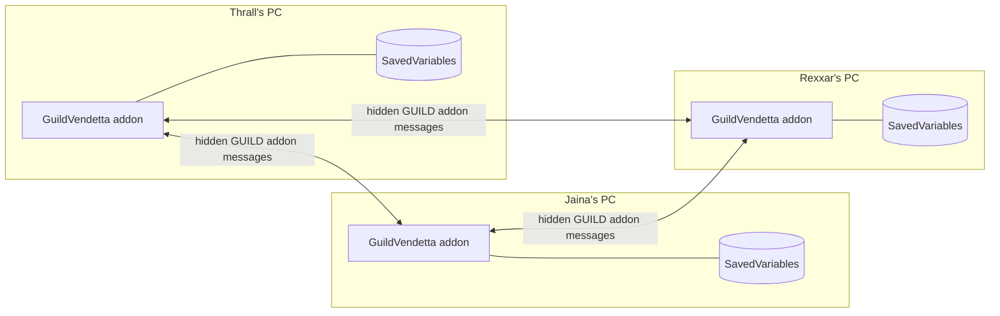
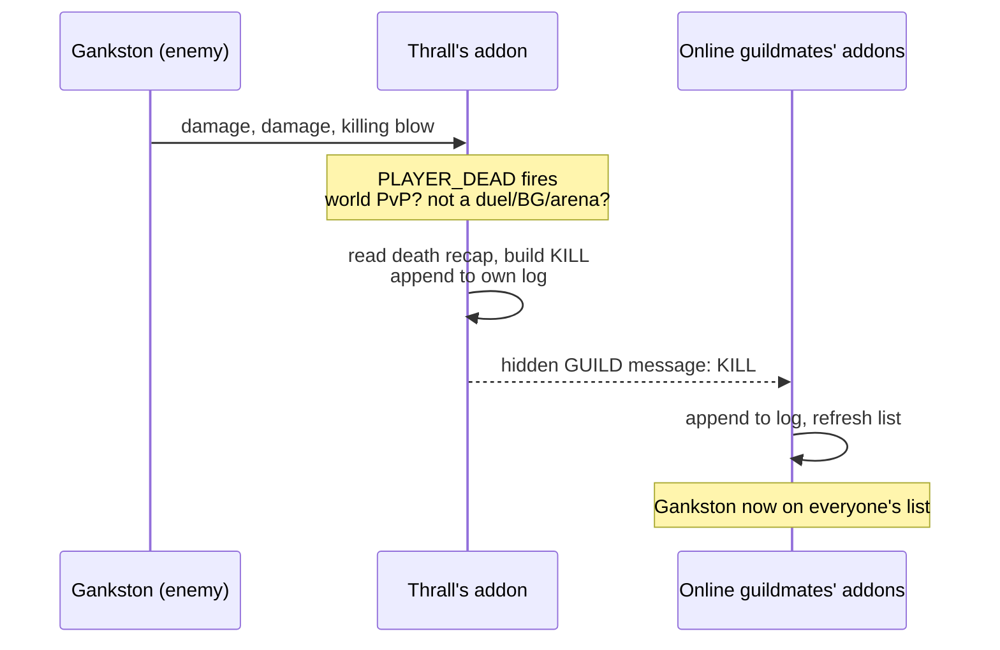
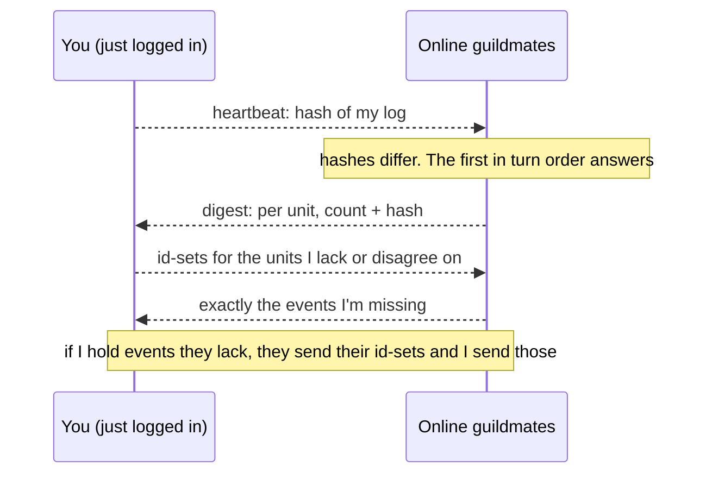
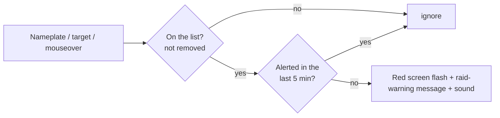

# Guild Vendetta

A **World of Warcraft: Forever** addon that keeps a guild-shared **vendetta list**: every enemy player who has killed you or one of your guildmates in world PvP. When someone on the list comes near you, the addon flashes your screen red, shows a raid-warning style message, and plays a warning sound.

## Features

- **Automatic kill tracking.** When a guildmate dies to enemy players, the kill is recorded the moment it happens.
- **Every contributor counts.** Every enemy player in the victim's **death recap** (Blizzard's "what killed you" summary) is listed, and the killing blow is marked. The design wanted everyone from the last 60 seconds, but WoW: Forever blocks the combat log for addons, so the recap is the only source (see [Known limitations](#known-limitations)).
- **Score.** Each enemy has a score: **their kills on us vs. our kills on them** (`3-1`). The list is sorted by their kills, so the worst offender is #1.
- **Vendettas.** When guildies take down a listed enemy, every guildie who helped gets credit. This is a *successful vendetta*.
- **Guild chat announcements.** Every guildie death (*"Todor Zhivkoff was killed by Yasashii Hinghtclaw in Alterac Mountains. Killer registered."*) and every successful vendetta (*"Thrall Durotan took down Yasashii Hinghtclaw. Successful vendetta! (3-1)"*) is posted in visible guild chat. It can be turned off in settings.
- **Revengers leaderboard.** A second tab ranks guildies by how many vendettas they've struck.
- **14-day memory.** Kills older than 14 days drop off the list. An enemy with no kills in the last 14 days disappears. The revengers leaderboard keeps every vendetta forever.
- **Proximity alerts.** You get a red screen flash, a raid-warning message and a sound when a listed enemy is seen nearby. Each part can be turned off. The same enemy alerts at most once every 5 minutes by default.
- **Shared across the guild, live.** Every guildmate running the addon sees the same list, and updates arrive within about a second.
- **Removal with the X button.** Any guild member can remove an enemy, and the removal applies to the whole guild.
- **Blizzard-native look.** The addon uses Blizzard's own frame templates and class-colored names, and its settings live in the standard *Options → AddOns* panel.
- **No server, no setup.** Every guild automatically has its own private list.

### World PvP only

The addon **only tracks world PvP**. Deaths in **battlegrounds, arenas, and duels are ignored**, as are deaths inside any other instance. Tracking those would bury the real grudges in noise.

### What each entry holds

| Field | Example |
|---|---|
| Enemy's full two-part name, class, race | Gankston Doe, Rogue, Undead |
| Enemy level at the time of the kill | `60`, or `??` when the game hides it (enemy far above your level) |
| Killing blow / contributor | ★ Gankston Doe, Stabbz Roe |
| Guildmate killed, and their level | Thrall Durotan (52) |
| Where | Stranglethorn Vale, Booty Bay outskirts (x, y) |
| When | server time of death |

## Install

The addon is for the **WoW: Forever** client (interface `16001`). Its folder must end up as `Interface/AddOns/GuildVendetta` inside the `_forever_` game folder:

| OS | AddOns folder |
|---|---|
| macOS | `/Applications/World of Warcraft/_forever_/Interface/AddOns` |
| Windows | `C:\Program Files (x86)\World of Warcraft\_forever_\Interface\AddOns` |

### Option 1: download the ZIP (players)

1. On the [repo page](https://github.com/danielgospodinow/guild-vendetta), click **Code → Download ZIP**.
2. Unzip it. Inside, open `guild-vendetta-main/addon/` and copy the **`GuildVendetta`** folder into your AddOns folder.
   - Copy only that folder, not the whole `guild-vendetta-main`. WoW only loads an addon whose folder name matches its `.toc` file (`GuildVendetta/GuildVendetta.toc`).
3. Restart the game, or `/reload` if it's running.

**To update:** delete the old `GuildVendetta` folder and repeat. Your list is kept, because it's stored in the `WTF` folder, not in the addon folder.

### Option 2: symlink a clone (developers)

This links the AddOns folder to a git clone, so `git pull` (or your own edits) shows up in-game after a `/reload`.

1. Clone the repo, for example `git clone https://github.com/danielgospodinow/guild-vendetta.git`.
2. From the clone's folder, create the link.

   macOS:
   ```bash
   ln -s "$PWD/addon/GuildVendetta" "/Applications/World of Warcraft/_forever_/Interface/AddOns/GuildVendetta"
   ```
   Windows, in a Command Prompt run as administrator:
   ```bat
   mklink /D "C:\Program Files (x86)\World of Warcraft\_forever_\Interface\AddOns\GuildVendetta" "%CD%\addon\GuildVendetta"
   ```
3. Restart the game, or `/reload` if it's running.

**To uninstall:** delete the link only (`rm` on macOS, `rmdir` on Windows). The clone stays untouched.

### If it doesn't show up

At character select, open **AddOns** and make sure *Guild Vendetta* is ticked. If it's listed as out of date, tick **Load out of date AddOns**.

## Commands

| Command | What it does |
|---|---|
| `/gv` or `/vendetta` | Open or close the window |
| `/gv test` | Preview the alert (flash, message, sound) |
| `/gv sync` | Ask online guildmates for anything you're missing |
| `/gv status` | Show the guild, entry counts, and whether the last death recap was readable |

## How it works

### No server: the guild is the database

WoW addons **cannot access the internet**, because in-game Lua has no HTTP. So the list lives **inside the game, on every guildmate's PC**:

- Each player's copy is saved in the addon's *SavedVariables* file. WoW writes it on logout and `/reload`.
- The copies are kept in sync with **hidden guild addon messages**.



### Hidden guild messages

WoW gives addons their own message channel, `C_ChatInfo.SendAddonMessage(prefix, text, "GUILD")`. These messages:

- are delivered to **every guildmate who is online** at that moment,
- are **never shown in chat**, and only addons listening on the same prefix (`GVND`) receive them,
- are **not stored by the game**. Anyone offline simply doesn't get them, so each addon keeps its own copy of the list.

Deadly Boss Mods, RCLootCouncil and other big addons sync data the same way.

Messages are limited to 255 bytes and are throttled by the client, so large transfers are split and paced.

### The list is an event log

Like a Kafka topic, the list is an append-only log of events. The difference is that the log is copied onto every guildmate's PC instead of living on a central broker. There are three event types:

| Event | Meaning |
|---|---|
| `KILL` | One guildmate death: victim, all enemy contributors (killing blow marked), levels, zone, coordinates, time |
| `REMOVE` | "Hide this enemy's kills (and vendettas) up to time T", with who removed them |
| `VENDETTA` | "Guildie X helped take down listed enemy Y", with time and zone. One per guildie who helped |

The list you see is **computed** from the log:

- An enemy shows up if they have at least one `KILL` from the last 14 days that is newer than their latest `REMOVE`.
- **Their score** counts those kills. **Our score** counts our kills on them since the latest `REMOVE`. Credits from several guildies within 60 seconds count as one kill.
- **Revengers** counts every `VENDETTA` credit per guildie, all-time.

Kills and removals older than 14 days are deleted. Vendettas are kept forever. Events never change once written, and merging two copies is just a union, so receiving the same event twice is harmless.

### Live updates: the death hook

The game fires an event the instant you die (`PLAYER_DEAD`). A second later the addon reads your **death recap**, builds the `KILL` event from the enemy players in it, and **broadcasts it immediately**, so online guildmates have it within about a second.



### Vendettas: taking them down

The game won't let addons read the combat log, so the addon can't see who damaged an enemy. It credits a guildie for a kill in two ways:

1. **The honorable-kill message.** When an enemy player dies, the game tells everyone who contributed (*"X dies, honorable kill…"*). Every guildie who gets that message for a listed enemy is credited.
2. **Fallback:** the guildie had the enemy targeted in combat within the last 60 seconds and then saw them dead.

Each credited guildie's addon appends a `VENDETTA` event and broadcasts it. The first one also announces it in guild chat. A vendetta only counts for an enemy who is on the list at that moment.

### Removal (the X button)

Clicking `[X]` appends a `REMOVE` event and broadcasts it, the same way as a kill:

- The enemy disappears from **every online guildmate's list immediately**. Offline guildmates pick it up at their next sync.
- Anyone who killed **alongside** the removed enemy keeps their kills on the list.
- If the removed enemy **kills a guildmate again**, they come back. A removal only clears kills up to the moment of removal, and **their score starts over** at `1-0`. The revengers leaderboard keeps its counts.
- `REMOVE` events are kept forever, so an old copy of the list can't bring a removed enemy back.

### Catching up: one check for login, reload and every few minutes

Every addon regularly checks whether its log matches the guild's. It does this **8 seconds after login or `/reload`, then every 4–6 minutes**, by broadcasting a **heartbeat**: one hash of its whole log. A guildmate whose hash matches stays silent, which is what happens almost every time. When hashes differ, the logs are reconciled with whoever is online right now, and only the missing events are sent:

1. **Heartbeat:** "my log hashes to X".
2. **Digest:** a guildmate whose hash differs answers with a summary of its log, unit by unit: "N events, hash X". A unit is one of the last 15 days, or a 30-day block for anything older. Old blocks only hold vendettas, so the summary stays about two messages long however old the guild is.
3. **Id-sets:** the out-of-date side compares unit by unit. For every unit it lacks or disagrees on, it lists a short fingerprint of each event it holds there (an empty list means "send me all of it"), all in one message.
4. **Events:** the other side sends exactly the events whose fingerprints are missing. If the list shows events *it* lacks, it answers with its own id-sets, and the first side sends those.

Guildmates with identical logs would give identical answers, so they **take turns**. For each request, every addon puts the guildmates it has heard from in the same order. The first answers after half a second, and each later place waits 2 seconds more. Normally only the first one sends anything, however many guildmates are online. If the first is AFK, the next one covers it 2 seconds later. All messages are broadcasts: the others stay quiet because they see the answer go by.



The catch: **a sync can only come from guildmates who are online.** If a kill happened while you were offline and everyone who has it is offline too, you get it the next time you're online together with any one of them. The heartbeat also heals live messages missed while online, for example during a loading screen, within a few minutes. The more of the guild runs the addon, the faster everything spreads.

**Want to see the actual messages?** [docs/sync-examples.md](docs/sync-examples.md) walks through live kills, vendettas, removals, a brand-new and a returning player logging in while four guildmates are online, `/reload`, heartbeats and multi-part messages, with real captured traffic decoded field by field.

### Proximity alerts

The game has no "scan the area" feature, so "nearby" means the enemy has been **seen by your client** in one of these ways:

- their nameplate appears,
- you target or mouse over them.

That's roughly nameplate range.



## Sync protocol reference

The exact rules, for anyone changing or reviewing the sync code (`addon/GuildVendetta/Sync.lua` and the digest functions in `Core.lua`). [docs/sync-examples.md](docs/sync-examples.md) shows each rule in real captured traffic.

### Starting point: the simple protocol, and what this one optimizes

The simplest correct design is this: everyone sends heartbeats, and any player who sees a log hash different from their own **sends all of their events**. Everyone keeps whatever is new to them. That guarantees a synchronized log in a single step, because after one round every online player holds the union of everyone's events.

This protocol keeps that guarantee and the same starting point (a heartbeat with one log hash), and adds two optimizations to cut traffic:

| Simple protocol | This protocol | Effect |
|---|---|---|
| Every player whose hash differs answers | **Turn order:** players with the same answer are sorted the same way, and only the first sends it. The rest see it on the channel and stay quiet | One answer per version of the log, however many guildmates are online |
| Each answer is the whole log | **Precise sending:** compare per-unit summaries, then fingerprints inside the units that differ, then send only the missing events | Traffic matches what's missing, not the size of the log |

With a 300-event log, a player who missed 2 events costs the simple protocol hundreds of event messages: the whole log from the in-sync side, and the drifting player's own log back. This protocol needs 5 messages. When everyone is in sync, both cost a single heartbeat.

### Message framing

Every message is a hidden addon message: prefix `GVND`, channel `GUILD`, at most 255 bytes. It starts with a 5-character header, then the payload:

| Position | Meaning |
|---|---|
| 1 | Kind: `E`, `B`, `H` or `I` |
| 2–3 | Message number, base36, per sender (so the parts of one message can be matched) |
| 4 | This part, base36 (`1`…`z`) |
| 5 | Total parts, base36 |
| 6… | Up to 245 characters of payload |

A payload too long for one message is split into parts and reassembled by sender and message number. Incomplete messages are dropped after 60 seconds. A message needing more than 35 parts is never sent.

### Message kinds

| Kind | Payload | Example |
|---|---|---|
| `E` event | one event, see below | `K~1795289030~Todor Zhivkoff~32~PALADIN~…` |
| `B` heartbeat | the log hash, in decimal | `2163612622` |
| `H` digest | `unit:count:hash` for every unit, oldest first, joined by `;` | `m690:1:585697855;20777:1:2408568836;20778:3:2395705750` |
| `I` id-sets | `unit:hash:fp,fp,…` for each listed unit, joined by <code>&#124;</code>. Hash `0` and no fingerprints means "I have nothing here, send all of it" | <code>20778:1900282881:1hj0ek,lmywsf&#124;20777:0:</code> |

### Events on the wire

Fields are separated by `~`. Text fields have `~ ^ , |` and newlines stripped before sending.

| Event | Fields | Derived ID (never sent) |
|---|---|---|
| `KILL` | `K~time~victim~victimLevel~victimClass~zone~subzone~mapID~x~y~enemies`. Enemies are joined by `^`, each `name,class,race,level,killingBlow(1/0),characterID` | `K:<victim>:<time>` |
| `REMOVE` | `R~time~enemyKey~removedBy` | `R:<enemyKey>:<time>` |
| `VENDETTA` | `V~time~enemyKey~enemyName~enemyClass~creditedGuildie~zone` | `V:<enemyKey>:<creditedGuildie>:<time>` |

`time` is server time in seconds. `enemyKey` is the enemy's character ID (GUID), or their name when the ID is unknown.

### Units, hashes and fingerprints

- **Hash:** `h = 5381`, then for each byte `h = (h × 33 + byte) mod 2^32` (djb2).
- **Unit:** an event from today or the 15 days before it (by server time) belongs to its day, written as days since 1970 (`20778`). Older events belong to a 30-day block, `m` + `floor(day / 30)` (`m690`).
- **Unit hash:** the hash of the unit's event IDs, sorted and joined by `;`.
- **Digest:** every unit as `unit:count:unitHash`, oldest first, joined by `;`.
- **Log hash** (sent in heartbeats): the hash of the digest.
- **Fingerprint:** `hash(eventID) mod 36^6`, written as 6 base36 characters (`lmywsf`).

### What a receiver does

Messages from your own character, or on any channel other than `GUILD`, are ignored. Everything else is handled like this:

| Arrives | The receiver… |
|---|---|
| `E` | adds the event if its ID is new, and notes that this event was just seen on the channel |
| `B` | does nothing if the hash equals its own log hash. Otherwise, at its turn, sends its digest (`H`), unless an identical digest went out since the heartbeat arrived |
| `H` | compares unit by unit. Units only it has: it sends their events. Units it lacks or disagrees on: it lists its fingerprints for all of them in one `I` (empty for units it lacks). Both happen at its turn |
| `I` | for each listed unit, sends its events whose fingerprints are missing from the list. If the list has fingerprints it doesn't have, it answers with its own `I` for those units. Both happen at its turn |

Login and `/reload` send a heartbeat after 8 seconds. After that, each addon sends one every 4–6 minutes (random within that range), and skips it while it still has messages to send. `/gv sync` sends the digest directly.

### Taking turns

Every answer (`H`, `I`, and events sent in reply) waits for the sender's turn:

1. The addon lists every guildmate it has heard on the channel in the last 10 minutes, plus itself, minus the requester.
2. It scores each name as `hash(name .. "|" .. requester .. "|" .. request)`. The request is the message kind plus the hash of its payload, for example `B2088435702`. Every addon computes the same scores, so they agree on the order without talking.
3. Sorted by score, place 0 answers after 0.5 s, and place *n* after 0.5 + 2*n* s, plus 0–0.3 s of jitter.
4. An addon online for less than 6 minutes adds 4 s, because it may not have heard everyone yet.
5. When its turn comes, the addon skips any answer that is already on the channel:
   - a digest or id-set message identical to the one it would send, seen since the request arrived;
   - any event seen since the request arrived, checked event by event just before sending.

Each addon sends at most one message part every 0.4 s, and live events jump the queue.

### Validation and trust

- Received events are checked before use: payload length (≤ 4000 characters), a plausible time, the exact number of fields, and 1–40 enemies per kill. Anything malformed is dropped.
- IDs are computed by the receiver, never taken from the sender, so content and ID always match.
- Any guild member can add and remove entries. The protocol trusts guildmates and accepts nothing from outside the guild channel.

### Guarantees

- **Convergence:** whenever two players are online together, a heartbeat (at most 4–6 minutes later) detects any difference and the exchange closes it. Every log converges to the union of all events anyone has seen. Order of arrival never matters.
- **Cost:** in sync, one heartbeat. Out of sync, a digest, one or two id-set messages, and exactly the missing events. The cost doesn't grow with the number of guildmates online.
- **Loss:** an event is lost only if its client crashes in the moment between recording it and the broadcast reaching anyone. An event held only by offline players waits until one of them is online with someone else.

### Designs considered and not used

| Alternative | Why not |
|---|---|
| "Send me everything after time T" | Loses events: a kill recorded while you were syncing with someone else is older than your watermark and is never requested |
| Whispers (`WHISPER` channel) between two players | The others stay quiet because they *see* the answer. Whispered answers are invisible, so everyone would answer, and bystanders who lack the same events wouldn't get them |
| Random 1–5 s waits instead of turns | Two waits ending within ~0.5 s both send everything in lockstep. Measured: avg 63 and worst 140 messages to deliver 20 events with 20 online, against exactly 20 with turns |
| Full dump: on a mismatch, send the whole log | Every small drift costs the whole log (hundreds of events, minutes of channel time), sent once by the in-sync side and again by the drifting player |
| Send whole differing units, no id-sets | Simpler (no `I`), but re-sends whole days, or a whole month of vendettas when an old block differs |
| Send the digest at login instead of a heartbeat (sync v2) | Costs the whole digest on every `/reload`, even when nothing changed |
| One digest entry per day forever | Vendettas never expire, so the digest would grow by a day for every day with a vendetta; 30-day blocks keep it at ~2 parts |

## Known limitations

- **No combat log on WoW: Forever.** Forever blocks the combat log for addons, and trying to use it triggers *"blocked from an action only available to the Blizzard UI"*. Kills come from the **death recap** instead. The recap only covers the last few hits before death, so an enemy who hit you earlier in the fight may be missing.
- **Vendetta credit is approximate.** Without the combat log, "everyone who damaged them" comes from the honorable-kill message or the targeting fallback (see [Vendettas](#vendettas-taking-them-down)). Which of the two Forever supports still needs checking in-game.
- **Enemies are matched by character ID**, not by name. Names are shown in full everywhere, because Forever characters have two-part names (for example *Todor Zhivkoff*).
- **Only the victim's client can record the kill**, because only it has the death recap. Guildmates without the addon won't contribute kills.
- **Pet kills aren't credited to the owner**, because the recap doesn't say who owns a pet.
- **Level may be `??`** when the game hides the enemy's level.
- **Offline catch-up needs a guildmate online** who has the missing data (see above).

## Self-hosting

There is nothing to host. Each guild's list lives in its members' game clients and is shared only over that guild's channel. Nothing is ever sent outside the guild.

## Repo layout

```
addon/GuildVendetta/       # the WoW addon (plain Lua, no libraries)
  Core.lua                 #   event log, ranked view, wire encoding, sync digests
  Capture.lua              #   death hook + death recap -> KILL
  Sync.lua                 #   hidden guild messages: live events + login catch-up
  Alerts.lua               #   nameplate/target/mouseover detection, flash/message/sound
  UI.lua                   #   window, minimap button, settings panel, /gv
probe/GuildVendettaProbe/  # diagnostic addon for the live client (#1)
tests/                     # plain-Lua tests, no WoW needed
docs/                      # design docs
```

## Development

### Probe addon (diagnostics)

`probe/GuildVendettaProbe` is a throwaway diagnostic addon for developers ([#1](https://github.com/danielgospodinow/guild-vendetta/issues/1)). It logs what the game lets addons read: the death recap, name lookups, enemy names and levels, and guild messages. Install it the same way as the addon (either option, using `probe/GuildVendettaProbe`), play a bit of world PvP, then `/reload`. Its log is saved to `WTF/Account/<account>/SavedVariables/GuildVendettaProbe.lua`. `/gvp ping` tests guild messages; guildmates running the probe answer with a pong.

### Tests

The tests run outside the game with [LuaJIT](https://luajit.org/) (`brew install luajit`):

```bash
luajit tests/core_test.lua
```

```bash
luajit tests/smoke_test.lua
```

`core_test` covers encoding, the ranked view, removal rules and sync digests. `smoke_test` loads the whole addon as three simulated guildmates with a stubbed WoW API and runs a death, live sync, a removal, login catch-up and an alert.

## Contributing

Features and bugs are tracked in [GitHub Issues](https://github.com/danielgospodinow/guild-vendetta/issues).

## License

See [LICENSE](LICENSE).
