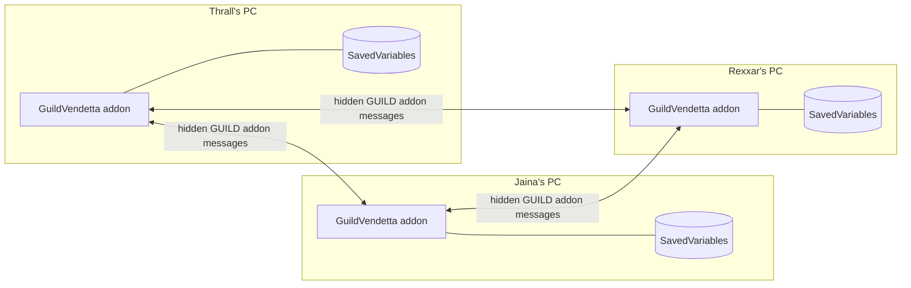
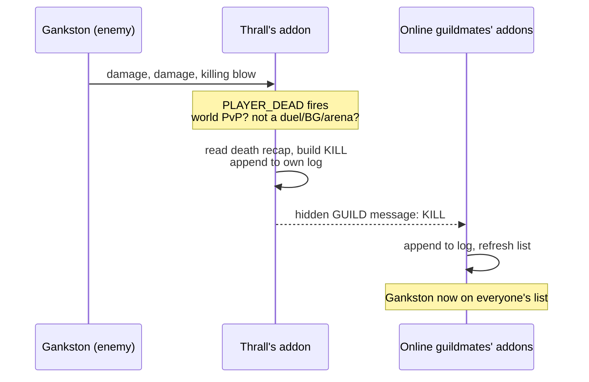
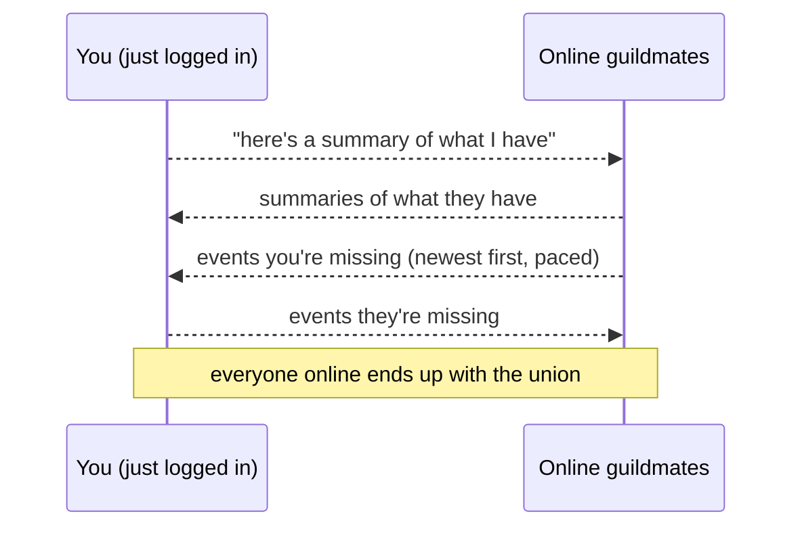
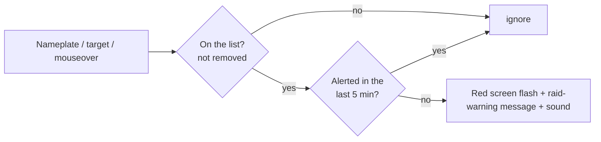
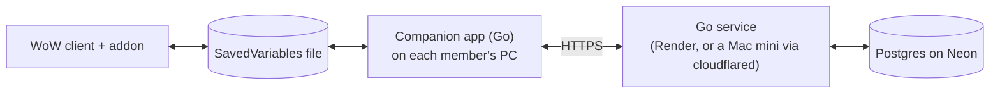

# guild-vendetta

A **World of Warcraft: Forever** addon that keeps a guild-shared **vendetta list**: every enemy player who has killed you or one of your guildmates in world PvP. When someone on the list comes near you, the addon flashes your screen red, shows a raid-warning style message, and plays a warning sound.

> **Status: v0.2.** Kill tracking is tested in the live client. Vendetta detection and sync between two players haven't been tested in-game yet. Work is tracked in [GitHub Issues](https://github.com/danielgospodinow/guild-vendetta/issues). The full design is in [docs/superpowers/specs/2026-11-21-guild-vendetta-design.md](docs/superpowers/specs/2026-11-21-guild-vendetta-design.md).

## Features

- **Automatic kill tracking.** When a guildmate dies to enemy players, the kill is recorded the moment it happens.
- **Every contributor counts.** Every enemy player in the victim's **death recap** (Blizzard's "what killed you" summary) is listed, and the killing blow is marked. The design wanted everyone from the last 60 seconds, but WoW: Forever blocks the combat log for addons, so the recap is the only source (see [Known limitations](#known-limitations)).
- **Score.** Each enemy has a score: **their kills on us vs. our kills on them** (`3-1`). The list is sorted by their kills, so the worst offender is #1.
- **Vendettas.** When guildies take down a listed enemy, every guildie who helped gets credit. This is a *successful vendetta*.
- **Guild chat announcements.** Every guildie death (*"Todor Zhivkoff was killed by Yasashii Hinghtclaw in Alterac Mountains. Killer registered."*) and every successful vendetta (*"Thrall Durotan took down Yasashii Hinghtclaw. Successful vendetta! (3-1)"*) is posted in visible guild chat. It can be turned off in settings.
- **Revengers leaderboard.** A second tab ranks guildies by how many vendettas they've struck.
- **14-day memory.** Kills older than 14 days drop off the list. An enemy with no kills in the last 14 days disappears. The revengers leaderboard keeps every vendetta forever.
- **Proximity alerts.** You get a red screen flash, a raid-warning message and a sound when a listed enemy is seen nearby. Each part can be turned off. The same enemy alerts at most once every 5 minutes by default.
- **Shared across the guild, live.** Every guildmate running the addon sees the same list, and updates arrive within about a second.
- **Removal with the X button.** Any guild member can remove an enemy, and the removal applies to the whole guild.
- **Blizzard-native look.** The addon uses Blizzard's own frame templates and class-colored names, and its settings live in the standard *Options → AddOns* panel.
- **No server, no setup.** Every guild automatically has its own private list.

### World PvP only

The addon **only tracks world PvP**. Deaths in **battlegrounds, arenas, and duels are ignored**, as are deaths inside any other instance. Tracking those would bury the real grudges in noise.

### What each entry holds

| Field | Example |
|---|---|
| Enemy's full two-part name, class, race | Gankston Doe, Rogue, Undead |
| Enemy level at the time of the kill | `60`, or `??` when the game hides it (enemy far above your level) |
| Killing blow / contributor | ★ Gankston Doe, Stabbz Roe |
| Guildmate killed, and their level | Thrall Durotan (52) |
| Where | Stranglethorn Vale, Booty Bay outskirts (x, y) |
| When | server time of death |

## The UI

```
┌[☠]─ Guild Vendetta ─────────────────────────────────────────────────[x]┐
│      [🔍 Search      ]                                       42 enemies │
├─────────────────────────────────────────────────────────────────────────┤
│  #  Enemy                 Score  Lvl  Victims                 Where   When │
│  1  - Yasashii Hinghtclaw  3-1    37  Todor Zhivkoff, Jaina…  Alterac  2h [x]│
│        taken down by Thrall Durotan, Jaina Proudmoore in Arathi, 1h ago   │
│        killed Todor Zhivkoff (32) in Alterac Mountains, The Headland      │
│        (39.9, 92.0), 2h ago, by *Yasashii Hinghtclaw, Muffe Kung          │
│        killed Jaina Proudmoore (30) in Hillsbrad Foothills, 1d ago, by …  │
│        killed Todor Zhivkoff (31) in Arathi Highlands, 3d ago, by …       │
│  2  + Muffe Kung           1-0    32  Todor Zhivkoff          Alterac  2h [x]│
├─────────────────────────────────────────────────────────────────────────┤
│ Last sync: 1m ago from Thrall Durotan                        [Settings] │
└─────────────────────────────────────────────────────────────────────────┘
 [Vendetta list] [Revengers]
```

**Revengers tab:**

```
│  #  Guildie            Vendettas  Last taken down          When │
│  1  Thrall Durotan         7      Yasashii Hinghtclaw       1h  │
│  2  Jaina Proudmoore       3      Muffe Kung                2d  │
```

- Open it with `/gv` or the minimap button. Escape closes it.
- **Score** is their kills (red) vs. our vendettas on them (green).
- **Victims** lists every guildie the enemy has killed.
- **Click a row** to expand that enemy's full history, newest first: every kill (victim, place, coordinates, contributors, killing blow `*`) and every vendetta (who took them down, where).
- **`[x]`** removes that enemy for the whole guild, after a confirmation. Their score starts over if they come back.

### Commands

| Command | What it does |
|---|---|
| `/gv` or `/vendetta` | Open or close the window |
| `/gv test` | Preview the alert (flash, message, sound) |
| `/gv sync` | Ask online guildmates for anything you're missing |
| `/gv status` | Show the guild, entry counts, and whether the last death recap was readable |

## Install

The addon targets the WoW: Forever client (interface `16001`).

1. Clone this repo.
2. Link the addon into your Forever AddOns folder (macOS paths shown):
   ```bash
   ln -s "$PWD/addon/GuildVendetta" "/Applications/World of Warcraft/_forever_/Interface/AddOns/GuildVendetta"
   ```
   On Windows, copy `addon/GuildVendetta` into `World of Warcraft\_forever_\Interface\AddOns\` instead.
3. Restart the game, or run `/reload` if it is already running.

### Probe addon (diagnostics)

`probe/GuildVendettaProbe` is a throwaway diagnostic addon ([#1](https://github.com/danielgospodinow/guild-vendetta/issues/1)). It logs what the game lets addons read: the death recap, name lookups, enemy names and levels, and guild messages. Link it the same way, play a bit of world PvP, then `/reload`. Its log is saved to `WTF/Account/<account>/SavedVariables/GuildVendettaProbe.lua`. `/gvp ping` tests guild messages; guildmates running the probe answer with a pong.

## How it works

### No server: the guild is the database

WoW addons **cannot access the internet**, because in-game Lua has no HTTP. So the list lives **inside the game, on every guildmate's PC**:

- Each player's copy is saved in the addon's *SavedVariables* file. WoW writes it on logout and `/reload`.
- The copies are kept in sync with **hidden guild addon messages**.



### Hidden guild messages

WoW gives addons their own message channel, `C_ChatInfo.SendAddonMessage(prefix, text, "GUILD")`. These messages:

- are delivered to **every guildmate who is online** at that moment,
- are **never shown in chat**, and only addons listening on the same prefix (`GVND`) receive them,
- are **not stored by the game**. Anyone offline simply doesn't get them, so each addon keeps its own copy of the list.

Deadly Boss Mods, RCLootCouncil and other big addons sync data the same way.

Messages are limited to 255 bytes and are throttled by the client, so large transfers are split and paced.

### The list is an event log

Like a Kafka topic, the list is an append-only log of events. The difference is that the log is copied onto every guildmate's PC instead of living on a central broker. There are three event types:

| Event | Meaning |
|---|---|
| `KILL` | One guildmate death: victim, all enemy contributors (killing blow marked), levels, zone, coordinates, time |
| `REMOVE` | "Hide this enemy's kills (and vendettas) up to time T", with who removed them |
| `VENDETTA` | "Guildie X helped take down listed enemy Y", with time and zone. One per guildie who helped |

The list you see is **computed** from the log:

- An enemy shows up if they have at least one `KILL` from the last 14 days that is newer than their latest `REMOVE`.
- **Their score** counts those kills. **Our score** counts our kills on them since the latest `REMOVE`. Credits from several guildies within 60 seconds count as one kill.
- **Revengers** counts every `VENDETTA` credit per guildie, all-time.

Kills and removals older than 14 days are deleted. Vendettas are kept forever. Events never change once written, and merging two copies is just a union, so receiving the same event twice is harmless.

### Live updates: the death hook

The game fires an event the instant you die (`PLAYER_DEAD`). A second later the addon reads your **death recap**, builds the `KILL` event from the enemy players in it, and **broadcasts it immediately**, so online guildmates have it within about a second.



### Vendettas: taking them down

The game won't let addons read the combat log, so the addon can't see who damaged an enemy. It credits a guildie for a kill in two ways:

1. **The honorable-kill message.** When an enemy player dies, the game tells everyone who contributed (*"X dies, honorable kill…"*). Every guildie who gets that message for a listed enemy is credited.
2. **Fallback:** the guildie had the enemy targeted in combat within the last 60 seconds and then saw them dead.

Each credited guildie's addon appends a `VENDETTA` event and broadcasts it. The first one also announces it in guild chat. A vendetta only counts for an enemy who is on the list at that moment.

### Removal (the X button)

Clicking `[X]` appends a `REMOVE` event and broadcasts it, the same way as a kill:

- The enemy disappears from **every online guildmate's list immediately**. Offline guildmates pick it up at their next sync.
- Anyone who killed **alongside** the removed enemy keeps their kills on the list.
- If the removed enemy **kills a guildmate again**, they come back. A removal only clears kills up to the moment of removal, and **their score starts over** at `1-0`. The revengers leaderboard keeps its counts.
- `REMOVE` events are kept forever, so an old copy of the list can't bring a removed enemy back.

### Catching up at login: sync only from online players

On login or `/reload`, your addon and the guildmates **who are online right now** compare which events each side has, and **each sends the other whatever it is missing**. Newest events go first, and the rest trickle in in the background at the game's message rate, about 1,000 events in roughly 15 minutes.



The catch: **a sync can only come from guildmates who are online.** If a kill happened while you were offline and everyone who has it is offline too, you get it the next time you're online together with any one of them. The more of the guild runs the addon, the faster everything spreads.

### Proximity alerts

The game has no "scan the area" feature, so "nearby" means the enemy has been **seen by your client** in one of these ways:

- their nameplate appears,
- you target or mouse over them.

That's roughly nameplate range.



## Known limitations

- **No combat log on WoW: Forever.** Forever blocks the combat log for addons, and trying to use it triggers *"blocked from an action only available to the Blizzard UI"*. Kills come from the **death recap** instead. The recap only covers the last few hits before death, so an enemy who hit you earlier in the fight may be missing.
- **Vendetta credit is approximate.** Without the combat log, "everyone who damaged them" comes from the honorable-kill message or the targeting fallback (see [Vendettas](#vendettas-taking-them-down)). Which of the two Forever supports still needs checking in-game.
- **Enemies are matched by character ID**, not by name. Names are shown in full everywhere, because Forever characters have two-part names (for example *Todor Zhivkoff*).
- **Only the victim's client can record the kill**, because only it has the death recap. Guildmates without the addon won't contribute kills.
- **Pet kills aren't credited to the owner**, because the recap doesn't say who owns a pet.
- **Level may be `??`** when the game hides the enemy's level.
- **Offline catch-up needs a guildmate online** who has the missing data (see above).

## Self-hosting

There is nothing to host. Each guild's list lives in its members' game clients and is shared only over that guild's channel. Nothing is ever sent outside the guild.

## Roadmap: optional server (option B)

A later, optional add-on to the above, tracked in [#9](https://github.com/danielgospodinow/guild-vendetta/issues/9):



This would add one central history, catch-up even when nobody is online, and a possible web view of the list. The cost is that every member installs a companion app, and server data reaches the game only on `/reload` or login. Each guild could run its own instance.

## Repo layout

```
addon/GuildVendetta/       # the WoW addon (plain Lua, no libraries)
  Core.lua                 #   event log, ranked view, wire encoding, sync digests
  Capture.lua              #   death hook + death recap -> KILL
  Sync.lua                 #   hidden guild messages: live events + login catch-up
  Alerts.lua               #   nameplate/target/mouseover detection, flash/message/sound
  UI.lua                   #   window, minimap button, settings panel, /gv
probe/GuildVendettaProbe/  # diagnostic addon for the live client (#1)
tests/                     # plain-Lua tests, no WoW needed
docs/                      # design docs
server/                    # (future) Go companion app + service, option B
```

## Development

The tests run outside the game with [LuaJIT](https://luajit.org/) (`brew install luajit`):

```bash
luajit tests/core_test.lua
```

```bash
luajit tests/smoke_test.lua
```

`core_test` covers encoding, the ranked view, removal rules and sync digests. `smoke_test` loads the whole addon as three simulated guildmates with a stubbed WoW API and runs a death, live sync, a removal, login catch-up and an alert.

## Contributing

Features and bugs are tracked in [GitHub Issues](https://github.com/danielgospodinow/guild-vendetta/issues).

## License

See [LICENSE](LICENSE).
